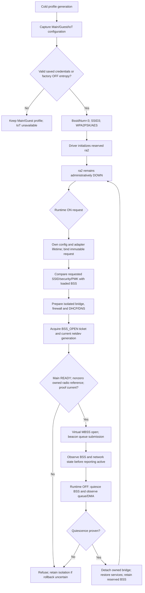

# WR1200JS precreated BSS lifecycle

Status: incomplete integration; source/host and scoped target evidence only.
See [acceptance contract](IOT-WIFI-IMPLEMENTATION-CONTRACT.md).

## Owner's pre-reservation acceptance checklist (2026-11-07)

The attached MBSSID pre-reservation request is part of the active IoT task.
Architecture A is preferred. Neither hidden SSID (B) nor a speculative vendor
command (C) is an accepted fallback. A credential mismatch must refuse runtime
activation, not silently regenerate the profile or restart the radio. First
provisioning and credential changes need a separately designed cold-apply path;
ordinary ON/OFF must use only the already provisioned BSS.

| Required completion label | Current status and evidence boundary |
|---|---|
| THIRD BSS RESERVED | Cold generator and scoped MIPS compilation verified; loaded ra2 pending |
| IOT RUNTIME ENABLE/DISABLE VERIFIED | Host controller fixture only; production backend unbound |
| NO PHYSICAL WIFI RESTART DURING IOT TOGGLE | Host reserved-mode dispatch excludes profile/radio preparation; real driver path pending |
| NO CHANNEL SCAN DURING IOT TOGGLE | Source design only; instrumented physical test pending |
| MAIN/GUEST REGRESSION TESTED | Injected state preservation only; associated clients pending |
| NETWORK ISOLATION VERIFIED | Earlier native network fixtures only; final image/device IPv4 and IPv6 tests pending |
| BUILD VERIFIED | Exact-revision scoped evidence in acceptance contract; latest full integration not built |
| PHYSICAL RUNTIME VERIFIED | RUNTIME PENDING; no device operation performed for this checklist |

`check-precreated-activation.c` now exercises every ten OFF recovery stages,
including persistent failure and subsequent retry. Failure of quiescence keeps
the live BSS attached and isolation retained; later failures never reopen it.
Successful retry retains the reserved profile and the current Main/Guest model
state. These are injected backend assertions, not evidence of RF quiescence.

The prepared RC user-config loader now filters whole logical lines, rather
than independently filtering each 255-byte `fgets` chunk. Long comments and
forbidden parameters no longer leak their continuation into the profile;
permitted long values retain continuation bytes even when a chunk begins with
`#`, `;` or a forbidden key prefix. The executable fixture extracts both the
actual prepared loader and actual vendor filter. Eleven cases pass host
ASan/UBSan, including exact chunk boundaries and unterminated final lines.
This is not a loaded-driver configuration receipt or proof that every radio
profile override is compatible with the reserved BSS.

Physical acceptance must record the firmware SHA, loaded profile identity,
Main/Guest client association and continuous traffic before, throughout and
after at least 100 IoT ON/OFF cycles. Record physical open/close, MCU restart
and channel-scan counters or equivalent traced call evidence (define the
instrumentation before testing). Required delta for ordinary toggles is zero.
For each cycle check IoT DHCP/DNS/internet, bidirectional IPv4/IPv6 isolation
from LAN and Guest, and actual RF silence/client rejection after OFF. Include
saved OFF/ON reboot cases and failed enable/disable recovery. A missing counter,
packet capture or observation remains pending, never a presumed zero. Flash,
reboot and state-changing device tests require separate owner authorization.

Runtime request transport, configuration lease and production backend calls in
this diagram are required integration work, not implemented receipts. The
existing one-use proof and key matcher are unbound components. A separate
readback ioctl followed by UP does not hold RTNL across both calls.

Pinned vendor references (c25283e):

| Path | Operation and limitation |
|---|---|
| ap/ap_mbss_inf.c:132 | MBSS_VirtualIF_Open dispatches MBSS_OPEN, virtual UP, CR_ENABLE |
| common/cmm_cfg.c:1034 | Physical open only at zero reference count; Main ownership must remain valid |
| common/cmm_cfg.c:1076 | Physical close on last reference; ordinary IoT OFF must not release Main |
| ap/ap_connect.c:1720 | Optional beacon MCU update under BCN_OFFLOAD_SUPPORT |
| mcu/andes_mt.c:2191 | CmdBcnUpdateSet requests no response; send result is not completion |
| common/cmm_mac_pci.c:2678 | MT_MAC beacon DMA submission under BcnRingLock |
| common/cmm_data_pci.c:750 | PCI kickout publishes descriptor/CIDX; submission is not drain |

Exact target macro evidence is now available for optional run42407287069,
revision7e2a644d: [AP/beacon reports](evidence/WR1200JS-IOT-AP-BEACON-TARGET-2026-11-07.json).
Both actual AP and beacon translation units have MBSS_SUPPORT=true and
BCN_OFFLOAD_SUPPORT=false, AIRPLAY_SUPPORT=false, WH_EZ_SETUP=false. Archived
macro/command hashes and the actual ELF32 MIPS module hash were independently
checked. This excludes the guarded beacon MCU update for this exact build,
not every possible MCU command during open/close. The MT_MAC CR enable/disable
in ap/ap_mbss.c:246/293 uses LPON/ARB MMIO. Its success alone is not DMA drain.
AsicSetMbssMode in hw_ctrl/cmm_asic_mt.c:566 also uses MMIO; the zero-reference
physical-open branch remains excluded only while the owned Main reference is
valid. Firmware startup/restart and data/station descendants remain separate.

The existing extracted vendor reference-count test passed1000 third-reference
cycles with zero physical open/close hook calls and distinct first/last-reference
behavior. It is now included in optional CI as vendor-virtual-no-restart.json;
it explicitly does not model beacon descendants, concurrency or merged driver
behavior. These limits must remain visible when using its result.

The RC disable-controller now has an explicit precreated mode:
`wr_iot_disable_begin_precreated` captures current service settings without
taking a radio-file snapshot; `wr_iot_disable_apply_services` uses the same
scoped DNS/gate teardown; `wr_iot_disable_apply_reserved` requires bridge
absence, administrative BSS DOWN and current settings ownership, and records
completion without changing the radio file. Commit retries retain this mode
and never fall through to legacy profile removal. The actual composition
fixture verifies no profile take/remove/commit calls, service failures,
bridge/DOWN/ownership refusal and finalization retry. Full controller TU also
compiles with actual headers using the CI gnu11 dialect. Target verification
and activation/backend call-site binding remain pending. RF/DMA quiescence,
loaded credential proof and Main/Guest lifetime remain the outer owner's
obligations; administrative DOWN is insufficient for those claims.

No ACK allocation/reuse changes are part of this strategy. Initial startup and
ordinary radio restart can still encounter the unresolved ROM ACK issue.
Physical WR1200JS tests must establish Main/Guest continuity, no channel scan,
IoT RF silence when OFF, DHCP/DNS/internet and IPv4/IPv6 isolation. A successful
build or DMA submission cannot establish those properties.
