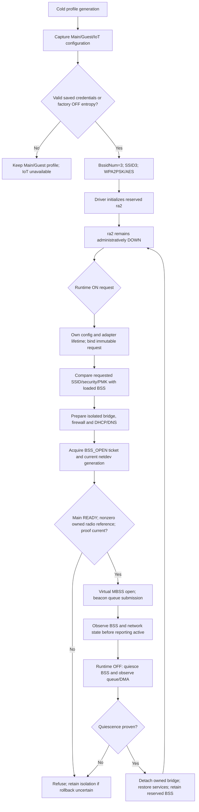

# WR1200JS precreated BSS lifecycle

Status: incomplete integration; source/host and scoped target evidence only.
See [acceptance contract](IOT-WIFI-IMPLEMENTATION-CONTRACT.md).

## Owner's pre-reservation acceptance checklist (2026-11-07)

The attached MBSSID pre-reservation request is part of the active IoT task.
Architecture A is preferred. Neither hidden SSID (B) nor a speculative vendor
command (C) is an accepted fallback. A credential mismatch must refuse runtime
activation, not silently regenerate the profile or restart the radio. First
provisioning and credential changes need a separately designed cold-apply path;
ordinary ON/OFF must use only the already provisioned BSS.

| Required completion label | Current status and evidence boundary |
|---|---|
| THIRD BSS RESERVED | Cold generator and scoped MIPS compilation verified; loaded ra2 pending |
| IOT RUNTIME ENABLE/DISABLE VERIFIED | Host controller fixture only; production backend unbound |
| NO PHYSICAL WIFI RESTART DURING IOT TOGGLE | Host reserved-mode dispatch excludes profile/radio preparation; real driver path pending |
| NO CHANNEL SCAN DURING IOT TOGGLE | Source design only; instrumented physical test pending |
| MAIN/GUEST REGRESSION TESTED | Injected state preservation only; associated clients pending |
| NETWORK ISOLATION VERIFIED | Earlier native network fixtures only; final image/device IPv4 and IPv6 tests pending |
| BUILD VERIFIED | Exact-revision scoped evidence in acceptance contract; latest full integration not built |
| PHYSICAL RUNTIME VERIFIED | RUNTIME PENDING; no device operation performed for this checklist |

`check-precreated-activation.c` now exercises every ten OFF recovery stages,
including persistent failure and subsequent retry. Failure of quiescence keeps
the live BSS attached and isolation retained; later failures never reopen it.
Successful retry retains the reserved profile and the current Main/Guest model
state. These are injected backend assertions, not evidence of RF quiescence.

The prepared RC user-config loader now filters whole logical lines, rather
than independently filtering each 255-byte `fgets` chunk. Long comments and
forbidden parameters no longer leak their continuation into the profile;
permitted long values retain continuation bytes even when a chunk begins with
`#`, `;` or a forbidden key prefix. The executable fixture extracts both the
actual prepared loader and actual vendor filter. Eleven cases pass host
ASan/UBSan, including exact chunk boundaries and unterminated final lines.
This is not a loaded-driver configuration receipt or proof that every radio
profile override is compatible with the reserved BSS.

Physical acceptance must record the firmware SHA, loaded profile identity,
Main/Guest client association and continuous traffic before, throughout and
after at least 100 IoT ON/OFF cycles. Record physical open/close, MCU restart
and channel-scan counters or equivalent traced call evidence (define the
instrumentation before testing). Required delta for ordinary toggles is zero.
For each cycle check IoT DHCP/DNS/internet, bidirectional IPv4/IPv6 isolation
from LAN and Guest, and actual RF silence/client rejection after OFF. Include
saved OFF/ON reboot cases and failed enable/disable recovery. A missing counter,
packet capture or observation remains pending, never a presumed zero. Flash,
reboot and state-changing device tests require separate owner authorization.

Runtime request transport, configuration lease and production backend calls in
this diagram are required integration work, not implemented receipts. The
existing one-use proof and key matcher are unbound components. A separate
readback ioctl followed by UP does not hold RTNL across both calls.

Pinned vendor references (c25283e):

| Path | Operation and limitation |
|---|---|
| ap/ap_mbss_inf.c:132 | MBSS_VirtualIF_Open dispatches MBSS_OPEN, virtual UP, CR_ENABLE |
| common/cmm_cfg.c:1034 | Physical open only at zero reference count; Main ownership must remain valid |
| common/cmm_cfg.c:1076 | Physical close on last reference; ordinary IoT OFF must not release Main |
| ap/ap_connect.c:1720 | Optional beacon MCU update under BCN_OFFLOAD_SUPPORT |
| mcu/andes_mt.c:2191 | CmdBcnUpdateSet requests no response; send result is not completion |
| common/cmm_mac_pci.c:2678 | MT_MAC beacon DMA submission under BcnRingLock |
| common/cmm_data_pci.c:750 | PCI kickout publishes descriptor/CIDX; submission is not drain |

Exact target macro evidence is now available for optional run42407287069,
revision7e2a644d: [AP/beacon reports](evidence/WR1200JS-IOT-AP-BEACON-TARGET-2026-11-07.json).
Both actual AP and beacon translation units have MBSS_SUPPORT=true and
BCN_OFFLOAD_SUPPORT=false, AIRPLAY_SUPPORT=false, WH_EZ_SETUP=false. Archived
macro/command hashes and the actual ELF32 MIPS module hash were independently
checked. This excludes the guarded beacon MCU update for this exact build,
not every possible MCU command during open/close. The MT_MAC CR enable/disable
in ap/ap_mbss.c:246/293 uses LPON/ARB MMIO. Its success alone is not DMA drain.
AsicSetMbssMode in hw_ctrl/cmm_asic_mt.c:566 also uses MMIO; the zero-reference
physical-open branch remains excluded only while the owned Main reference is
valid. Firmware startup/restart and data/station descendants remain separate.

The existing extracted vendor reference-count test passed1000 third-reference
cycles with zero physical open/close hook calls and distinct first/last-reference
behavior. It is now included in optional CI as vendor-virtual-no-restart.json;
it explicitly does not model beacon descendants, concurrency or merged driver
behavior. These limits must remain visible when using its result.

The RC disable-controller now has an explicit precreated mode:
`wr_iot_disable_begin_precreated` captures current service settings without
taking a radio-file snapshot; `wr_iot_disable_apply_services` uses the same
scoped DNS/gate teardown; `wr_iot_disable_apply_reserved` requires bridge
absence, administrative BSS DOWN and current settings ownership, and records
completion without changing the radio file. Commit retries retain this mode
and never fall through to legacy profile removal. The actual composition
fixture verifies no profile take/remove/commit calls, service failures,
bridge/DOWN/ownership refusal and finalization retry. Full controller TU also
compiles with actual headers using the CI gnu11 dialect. Target verification
and activation/backend call-site binding remain pending. RF/DMA quiescence,
loaded credential proof and Main/Guest lifetime remain the outer owner's
obligations; administrative DOWN is insufficient for those claims.

Target follow-up (2026-11-08): ABI run42410701865 succeeded for6e7b018.
The actual 15444-byte ELF32 little-endian MIPS ET_REL controller object was
independently parsed; its defined symbol table contains nonempty reserved
begin/apply and commit functions. See [object evidence](evidence/WR1200JS-IOT-RESERVED-OFF-TARGET-2026-11-08.json).
This closes the scoped target translation-unit gate, not linked RC/image,
activation binding or device runtime. Optional run42436571351 verifies the
same exact revision separately.

No ACK allocation/reuse changes are part of this strategy. Initial startup and
ordinary radio restart can still encounter the unresolved ROM ACK issue.
Physical WR1200JS tests must establish Main/Guest continuity, no channel scan,
IoT RF silence when OFF, DHCP/DNS/internet and IPv4/IPv6 isolation. A successful
build or DMA submission cannot establish those properties.

Integrated host follow-up: the request-snapshot fixture now links the actual
request-stage, request-snapshot, disable-services, disable-controller and
profile units. All six partial temporary-credential cleanup failures retain
reserved mode, lock and receipt, keep gates closed and complete on retry.
A foreign credential change after reserved-apply refuses commit without writes;
it remains untouched and ownership stays retained. ASan/UBSan passes. DNS,
NVRAM and netdev hooks remain injected; no RF or production backend claim.
ABI workflow now links these units for this fixture; new CI execution pending.

Owner decision (2026-11-08): a new documented Linux RC-to-driver API is
explicitly authorized. Firmware protocol and stale-ACK protection remain
unchanged. New driver-api-wire.h defines a144-byte OPEN request: WRI1/op1,
BE64 adapter epoch and netdev generation,16-byte nonzero request identifier,
explicit SSID/key lengths, zero reserved bytes and canonical zero padding.
Decoder wipes output on refusal and its temporary credential copy on every
exit. Syntax acceptance grants no driver permission. Admission must validate
UTF-8/security, derive and compare PMK under task/config ownership, revalidate
registry/ticket/epoch, and invoke the existing MBSS open within that ownership.
No key/PMK may be returned. Retry/status must use nonsecret transaction identity.

Transport audit: pinned net/core/dev_ioctl.c serializes SIOCDEVPRIVATE through
RTNL, but its default private branch does not itself check CAP_NET_ADMIN.
The new driver entry must check namespace capability explicitly. Vendor
rt_os.h's0x8BE0 SIOCDEVPRIVATE fallback applies only to WIRELESS_EXT<=11;
normal Linux private-device range and WEXT range must not be conflated.
No ioctl number, dispatcher binding or production activation is installed yet.
The existing wr_iot_linux_ioctl_raw wrapper holds a control admission; blindly
routing OPEN beneath it would conflict with the BSS_OPEN owner. Resolve this
explicitly when binding the new entry, retaining all non-IoT admission rules.

New API entry implementation is staged as driver-api-open-entry.inc, still
uninstalled: under the kernel ioctl RTNL contract it checks namespace
CAP_NET_ADMIN before copying144 bytes once, rejects non-MT7603/already-running
interfaces, decodes the request, requires strong request_enter ownership, calls
existing dev_open, always leaves an entered owner, and reports EUCLEAN if owner
release cannot be confirmed. Both local wire and decoded credentials are wiped.
Its success is netdev-open completion only; RF/network observation is separate.
The extracted actual entry passes host ASan/UBSan privilege, copy, syntax,
stale-owner, open-error and leave-error tests with injected kernel hooks.
No permissive owner implementation, ioctl number or dispatcher was added.
The CI host fixture list now includes wire/entry tests; target proof pending.

OPEN owner model now reserves the existing BSS_OPEN ticket and registry slot
before dev_open, under the transition lock. It refuses active control users,
blocked control/bootstrap state, stale expected epoch/generation or missing
owned Main/vendor count. MBSS must borrow that same ticket and consume the
request once for the same task/netdev; it must not start a second ticket.
Unconsumed current reservation can be canceled when dev_open fails before
ndo_open. Uncertain consumed/ticket retirement poisons the owner and wipes
credentials/task pointer while retaining nonsecret claim/ticket recovery
identity; retained pointer identity is not a lifetime pin. No automatic poison
clear is supplied. Host ASan/UBSan model tests pass. Driver adapter fields,
control exclusion, credential compare and MBSS entry binding remain required.

Adapter request enter/leave wrappers are implemented locally in
 driver-api-owner-binding.inc. Enter checks actual MT7603 third-netdev mapping
and bounded BssidNum while holding wr_iot_transition_lock, then reserves against
actual registry/vendor count/control/bootstrap state. Leave uses the same lock
and propagates uncertain owner state into wr_iot_control_poisoned. The actual
wrappers, OPEN entry and owner model pass a composed ASan/UBSan fixture; only
kernel/netdev hooks and device-open body are injected. A fixture-only current
macro initially collided with the wrapper task argument and was corrected to
use a distinct current_task_identity symbol. No target-source change was needed
for that harness failure. Driver fields/dispatcher and MBSS borrow/key proof
still need a checked generator; this code is not installed or target-verified.

Checked candidate installer prepare-driver-api.py is implemented locally.
It refuses changed manifests/anchors or an existing literal0x89ff collision,
adds/initializes adapter owner storage, guards control admission while owner
is active/poisoned, and routes WR_IOT_DRIVER_IOCTL_OPEN0x89ff before the ordinary
control lease. The audited pinned driver uses WEXT private0x8be0+ commands;
this newly allocated Linux device-private slot is an explicit new API.
Third-BSS MBSS open consumes its already reserved request/ticket, compares
loaded PMK outside the spinlock, and revalidates the same claim before raw open.
Main/Guest retain their previous admission path. No firmware command added.

Installer applied successfully to an exact hash-checked copy of the retained
channel-scan candidate, after its precreated-admission layer. Source ordering
checks pass; four API host fixtures pass ASan/UBSan. This retained candidate
predates latest CI and this is not target proof. The temporary source copy
was removed automatically. Installer is not yet enabled in the full pipeline:
existing extraction checkers need to understand the changed wrapper, and fresh
whole-TU/module compilation must pass before publication. A nonsecret identity
query for RC to obtain the expected epoch/netdev generation is also required.

The actual transformed MBSS wrapper now passes an executable host fixture:
correct key/Main accepts one borrowed ticket; key mismatch or reset during
key work never reaches raw-open; ordinary third-BSS open without an API owner
refuses; Guest follows its previous path. Post-open observation failure leaves
radio UNVERIFIED and the API owner refuses clean completion. The owner binding
also wakes ticket waiters outside its lock when canceling before ndo_open.
The composed entry test verifies this early cancellation and waiter wake.

The installer/checker is now staged at the end of peer82 preparation, after
predecessor extraction fixtures and before final source copy/hash/Kbuild.
The API's transformed wrapper has its own executable fixture. Predecessor
fixture success must not be represented as exercising final API semantics.
Fresh GitHub target compilation and nonsecret identity query remain pending.

Local API follow-up adds CLOSED-BSS identity ioctl0x89fe. It requires RTNL and
namespace CAP_NET_ADMIN, verifies exact third BSS, owned Main/vendor references,
idle/nonpoisoned control/bootstrap and READY/nonreset/PM state under the same
transition lock, then copies a zero-initialized32-byte WRI1/op2 response outside
the lock. Response contains only BE64 adapter epoch and netdev generation;
no SSID/key/PMK and no admission ticket. OPEN still rejects stale identities.
Wire tests cover64-bit endianness, exact lengths, reserved bytes and zero output
on refusal. Actual query entry is composed with adapter owner in ASan/UBSan
fixture: privilege before copy, wrong-device/reset/poison refusal, copy error,
correct response and no ticket/owner mutation all pass. Checked installer routes
both new ioctls and audits both literal numbers. Retained-source generation and
MBSS regression pass. New identity code remains local; MIPS query proof pending.

RC transport now has driver-api-client.c/.h: fixed ra2, CLOEXEC datagram socket,
strict identity response decode and canonical OPEN encoding. Failure before
OPEN ioctl is NOT_SUBMITTED; any attempted ioctl error or subsequent close
error is OPEN_UNCERTAIN. OPEN_COMPLETED means synchronous netdev-open only,
never device/network acceptance. No automatic ioctl retry or logging of keys.
The client wipes its wire credential buffer on all exits. Actual client host
fixture passes ASan/UBSan with injected socket/ioctl/close, including partial
outcome classification. Prepared RC stages/links the client and ABI workflow
compiles its MIPS object; the actual staging block/native TU and YAML parse
pass locally. Full fresh generation and target client proof remain pending.
Activation call sites still need to map uncertainty into retained recovery.

RC client now composes a validated ON request and exact32-lowercase-hex control
transaction ID with a fresh driver identity, then sends OPEN once. All-zero ID,
OFF/malformed/unterminated credentials and invalid identity refuse before OPEN.
Internal credential snapshot is wiped on every exit; caller request is unchanged.
Actual client ASan/UBSan fixture verifies transaction-byte mapping, unchanged
input, query failure without OPEN and uncertainty after failed OPEN following
successful query. Network isolation/cancellation/recovery remain outer backend
requirements; this helper does not by itself bind control-server activation.

New integration counterexample: check-driver-api-incarnation.c demonstrates
that a syntactically valid old OPEN request can pass owner admission after a
fresh adapter reconstructs epoch1 and the same registry generation sequence.
This is model admission, not a physical open: PMK/hardware checks still apply.
Do not call current identity/open binding safe across adapter recreation.
Required correction: identity query must carry the RC transaction nonce and
record a one-use query challenge in the current adapter; OPEN must consume that
challenge alongside epoch/generation. Fresh adapter starts without a challenge,
so old queried requests refuse even when numeric counters repeat. This avoids
relying on an assumed persistent module counter or unverified kernel entropy.
Counterexample is a known-gap demonstration, not a passing acceptance fixture;
convert it to stale-recreation refusal coverage when the challenge is bound.

Incarnation correction implemented locally: wire version is now WRI2, with
op3 identity request carrying the16-byte RC nonce and op2 identity response.
WRI1 requests/responses are rejected without fallback. Query arms nonce plus
observed epoch/generation in the current adapter owner, without retaining a
task/netdev pointer across userspace calls. OPEN requires exact nonce and query
identity and consumes query validity when its existing BSS_OPEN ticket is
reserved. A reconstructed adapter has no armed query, even if counters repeat.
Failed response copy drops only the matching challenge under the same lock.
This is not a defense against a privileged caller deliberately re-querying an
old transaction; RC mailbox single-use ownership remains required.

The previous incarnation counterexample is now a refusal regression. Six API
host fixtures and actual generated MBSS regression pass ASan/UBSan, including
wrong nonce, consumed query, response-copy invalidation and WRI1 rejection.
RC requested-open passes the same transaction nonce through query and OPEN and
wipes credentials. This closes the demonstrated model admission gap; final
kernel target and device lifecycle remain unverified. No ACK protocol change.

OFF receipt preflight now has mbss-close-receipt.h. It accepts only the exact
published MBSS registration/generation, original open token, completed local
close serial/stage4, no uncertain/running close and a nonlast admitted close.
It also requires current READY Main ownership and matching live vendor refs.
It intentionally does not require global retired_serial equality: another
interface can finish after this BSS. Seventeen invalid-state mutations refuse
under the host sanitizer test; this preflight grants no RF/drain/isolation
release permission and is not yet installed into a CLOSED ioctl.

Pinned close source trace: ap/ap_mbss.c:423 MbssKickOutStas ->
ap/ap_assoc.c:3143/3172 per-BSS APMlmeKickOutSta -> MacTableDeleteEntry at3245 ->
mgmt/mgmt_entrytb.c:960 RTMP_STA_ENTRY_MAC_RESET ->
include/mac/mac_mt/mt_mac_pci.h:520 AsicDelWcidTab ->
hw_ctrl/cmm_asic_mt.c:3477 WTBL MMIO and bounded IU_BUSY polling. The isolated
peer-retirement chain already replaces unchecked WCID deletion with
wr_iot_delete_wcid_checked; do not propose another pristine-only fix. The
CmdProcAddRemoveKey name also denotes WTBL MMIO in this pinned MT_MAC source,
not sufficient evidence of a firmware command. Beacon gate revoke/drain is
bound by prepare-beacon-producer-candidate.py; CR readback and zero outstanding
DMA/TxS snapshots remain distinct from proof of late callback/FIFO retirement.
Future CLOSED status must combine local receipt and appropriate hardware/producer
observations under lifetime/transition ownership, never expose stage4 as RF proof.

Local CLOSED configuration observer is implemented in mt7603-closed-observe.h.
Under BcnRingLock it checks Main UP/beacon request, exact IoT netdev DOWN with
beacon intent clear, revoked/idle producer gate, main ARB queue enabled, IoT
queue17 disabled and IoT LPON TBTT/PRE_TBTT interrupts disabled. It rejects all-ones
register reads and invalid adapter flags. Existing DMA/TxS outstanding helpers
run outside BcnRingLock to avoid recursive locking; afterward the observer
rechecks the configuration and same producer generation. Post-MMIO flag drift
also refuses. Host ASan/UBSan fixture passes19 negative cases plus valid state.
This is configuration plus outstanding snapshots, not proof of RF silence,
FIFO drain or late-callback retirement; it cannot alone release isolation.
Not installed into a CLOSED query or used by production activation yet.

Closed observation serialization now uses a distinct BSS_OBSERVE ticket.
Generic VERIFY was unsuitable: it clears main_ready and failed verification
can fault Main, even when only the IoT observation is negative. BSS_OBSERVE
requires READY Main, excludes participating mutators, and retires through a
separate non-mutating end helper that preserves every current readiness/intent
bit. Generic radio_finish explicitly refuses this operation. Closed-probe
begin checks the exact local receipt; finish revalidates that receipt, vendor
count and its own epoch/serial, then retires even a negative observation without
inventing Main readiness. Invalidated results refuse; foreign ticket cannot
be retired and retained context remains active. Caller must wake waiters after
retirement. No RF/isolation acceptance is supplied by this model.
Host ASan/UBSan probe tests and existing radio transition, owner/open and closed
observer regression fixtures pass. New operation/probe remain local and have
not been compiled as the final MIPS candidate or installed into a CLOSED ioctl.

Internal adapter CLOSED probe binding now composes real transition-lock
begin/finish with unlocked configuration readback. It refuses active control,
bootstrap or OPEN owners, wakes waiters only after retiring its exact ticket,
and returns EAGAIN for negative configuration without changing Main readiness.
Foreign ticket retirement failure returns EUCLEAN, retains caller-owned probe
context/lifetimes and poisons controls; caller must not discard it or proceed
with teardown. The composed host fixture passes these paths with injected MMIO.
No user CLOSED ioctl or RC activation acceptance is connected yet.

The checked API installer now stages the CLOSED headers and emits an internal
used probe function in rt_main_dev.c for target compilation. Optional peer82
requires its nonempty defined ELF symbol after Kbuild. This ensures later
build evidence covers generated machine code rather than an unused header.
Retained-source generation and actual MBSS regression pass; fresh target
result remains pending. This code still does not prove RF/FIFO/late-callback
retirement or allow isolation release solely on configuration snapshots.

Successful OPEN now retains a nonsecret receipt on the adapter owner: exact
request nonce, device identity, epoch, registry generation and acquired open
token. It is created only after consumed OPEN has a published owned MBSS ref
and clean current READY completion. Unmutated refusal creates no new receipt;
uncertain completion invalidates it. Credential/task buffers are still wiped.
Stored pointer identity is never a lifetime pin and must match current registry
before use. Receipt matching requires no active/poisoned owner and exact nonce
and tuple. Fresh reconstructed owner has no receipt.

Host sanitizer receipt fixture verifies these conditions and composes a later
nonlast close record/probe with the original OPEN receipt. The actual generated
MBSS fixture also confirms receipt creation after its successful path and no
clean completion on unverified observation. This is not RF status or a CLOSED
wire endpoint yet. RC OFF must retain the original successful ON transaction
ID for the driver query, separately from the new OFF mailbox transaction ID;
substituting the OFF ID would not prove closure of that activation. Recovery
must retain both the activation identity and its own result transaction.

Local CLOSED configuration ioctl0x89fd now accepts a canonical64-byte WRI2/op4
query containing the original successful ON nonce. It requires namespace
CAP_NET_ADMIN/RTNL, matches the current adapter's retained OPEN receipt and
registry generation, and runs the actual persistent BSS_OBSERVE probe. After
revalidation it returns a zero-initialized WRI2/op5 response containing nonce,
epoch/generation, open-token, close serial and exactly CONFIGURATION_CLOSED=1.
Unknown flags, malformed lengths/reserved bytes and mismatched nonce refuse.
No RF/FIFO/late-callback flag exists; this response alone cannot grant isolation
release. Active uncertain probe returns EUCLEAN with persistent context retained.

Checked installer stages/initializes the persistent probe, audits all three
ioctl literals and routes the new endpoint before ordinary control admission.
Actual CLOSED entry fixture passes13 cases with injected MMIO/syscalls, including
wrong/absent OPEN receipt, incomplete close, DMA/queue/reset failure, foreign
ticket retention, privilege/copy errors and safe read-only query retry after
response copy failure. Wire, OPEN receipt/owner and generated MBSS regressions
pass ASan/UBSan. New endpoint remains local, not yet target/runtime verified;
RC CLOSED transport and recovery consumption are the next integration step.

RC CLOSED client now performs one fixed-ra2 CLOEXEC query using the original
ON nonce, closes the socket once, and decodes only the exact matching WRI2
CONFIGURATION_CLOSED response. Socket/ioctl/close errors, other nonce/version,
unknown flags or zero tuple fields clear output and return unconfirmed. No
automatic retry or RF/isolation-release interpretation. Actual client host
fixture covers these failures and the valid tuple. Full client TU compiles
natively; exact MIPS client/query module verification remains pending.

Recovery boundary remains open: an uncertain attempted OPEN with no successful
OPEN receipt cannot be declared REJECTED just because CLOSED lacks a receipt.
The future backend must retain quarantine/recovery and obtain separately proven
failed-open closure; successful-OPEN CLOSED reporting covers only its defined
history. Do not silently downgrade uncertainty to an unmutated refusal.

ABI asset preservation correction (2026-11-08): run42440703274 failed at
check-candidate-assets.py:33 for radio-transition.h. Historical generators
require its exact reviewed CRLF-normalized bytes. Keep that base frozen;
radio-transition-api.h contains the reviewed BSS_OBSERVE extension. API owner/
closed-probe native code includes the extension first; the final checked API
installer alone replaces the candidate radio header after historical layers.
check-radio-transition-api.py verifies exact derivation from the frozen base
with only the approved additions. Original10 asset pins are unchanged and
LF/CRLF/tamper checks pass. Monitor42440963466 artifact13600669739 identified
the correct source run/step and causal assert; original failed log confirms it.
No monitor parser change needed. Fresh target rerun remains required.
