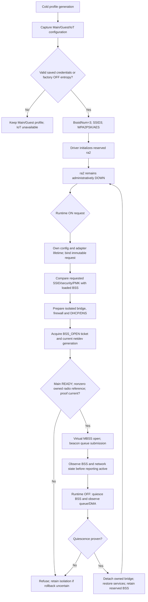

# WR1200JS precreated BSS lifecycle

Status: incomplete integration; source/host and scoped target evidence only.
See [acceptance contract](IOT-WIFI-IMPLEMENTATION-CONTRACT.md).

Runtime request transport, configuration lease and production backend calls in
this diagram are required integration work, not implemented receipts. The
existing one-use proof and key matcher are unbound components. A separate
readback ioctl followed by UP does not hold RTNL across both calls.

Pinned vendor references (c25283e):

| Path | Operation and limitation |
|---|---|
| ap/ap_mbss_inf.c:132 | MBSS_VirtualIF_Open dispatches MBSS_OPEN, virtual UP, CR_ENABLE |
| common/cmm_cfg.c:1034 | Physical open only at zero reference count; Main ownership must remain valid |
| common/cmm_cfg.c:1076 | Physical close on last reference; ordinary IoT OFF must not release Main |
| ap/ap_connect.c:1720 | Optional beacon MCU update under BCN_OFFLOAD_SUPPORT |
| mcu/andes_mt.c:2191 | CmdBcnUpdateSet requests no response; send result is not completion |
| common/cmm_mac_pci.c:2678 | MT_MAC beacon DMA submission under BcnRingLock |
| common/cmm_data_pci.c:750 | PCI kickout publishes descriptor/CIDX; submission is not drain |

No ACK allocation/reuse changes are part of this strategy. Initial startup and
ordinary radio restart can still encounter the unresolved ROM ACK issue.
Physical WR1200JS tests must establish Main/Guest continuity, no channel scan,
IoT RF silence when OFF, DHCP/DNS/internet and IPv4/IPv6 isolation. A successful
build or DMA submission cannot establish those properties.
