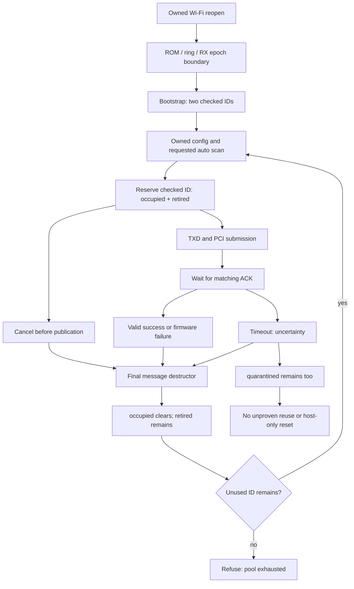

# WR1200JS MT7603E: ACK exhaustion та upstream ACK-intent fix

Дата: 2026-11-07. **BLOCKER: BLOCKED / NOT COMPLETED.**
Небезпечний workaround не застосовано. Runtime acceptance відсутнє.

## Висновок і рівень доказів

1. Підтверджено source/host counterexample: приватний reload/config шлях має
   лише15 одноразових checked ID. Два використовує bootstrap. Автосканування
   11/13 каналів потребує щонайменше22/26 channel/TX-power транзакцій. Тому
   навіть усі успішні ACK і своєчасне звільнення messages не дозволяють завершити
   цей scan у поточній моделі. Це **intentional retirement exhaustion**, не
   доведений memory/occupied-ID leak.
2. Upstream patch виправляє інший підтверджений механізм: no-wait команди
   породжують відповіді, які залишаються в shared MCU response queue.
   У перевіреному vendor PCI RX шляху такої host response backlog немає:
   seq0 обробляється негайно як unsolicited; інші події відразу зіставляються
   з `ackq` messages, потім RX object звільняється. `ackq` тут — список запитів,
   не накопичувач отриманих ACK skb.
3. Vendor TXD справді може встановити ACK незалежно від `need_wait`, бо
   використовує `need_rsp`. Один явний випадок серед70 initializer callsites:
   `CmdSecKeyReq`, FALSE/TRUE. У всьому перевіреному mt76x3 дереві є лише його
   визначення та прототип, без знайдених викликів/посилань. Це не доводить
   глобальну недосяжність зовнішнім кодом, але не підтверджує джерело scan failure.
4. Підстав для еквівалентного production fix наразі немає. Глобально зв'язувати
   `need_rsp` із `need_wait`, вимикати ACK або cherry-pick mt7996 було б
   неперевіреною зміною shared vendor protocol. Навіть усунення цього одного
   ACK-intent випадку не змінить15-ID budget для checked scan commands.

Фізичне відтворення на WR1200JS не виконувалося. Останні ізольовані candidates
не встановлені у production; поточні init guards навмисно відмовляють ранньому
RX/TX/AP/coexistence admission. Scan budget — умовний source counterexample
для потрібного успішного шляху, а не твердження, що саме цей код уже виконав
повний scan на пристрої. Чистий cold-start може не проходити private reload;
не слід переносити висновок на кожне завантаження.

## Ідентичність джерел

- Vendor snapshot: `c25283e915a2a00a763774dd255b14aff997285e`, subtree
  `trunk/linux-4.4.x/drivers/net/wireless/mediatek/mt76x3`.
  [TXD та RX implementation](https://github.com/Andrzej1973/padavan-4.4.198/blob/c25283e915a2a00a763774dd255b14aff997285e/trunk/linux-4.4.x/drivers/net/wireless/mediatek/mt76x3/mcu/andes_mt.c),
  [vendor lifecycle](https://github.com/Andrzej1973/padavan-4.4.198/blob/c25283e915a2a00a763774dd255b14aff997285e/trunk/linux-4.4.x/drivers/net/wireless/mediatek/mt76x3/mcu/andes_core.c).
- Current generators/fragments in this checkout establish the private policy;
  their source is distinct from the pinned SDK. Retained generated input:
  `/tmp/wr-iot-tx-owner.DR53cL/mbss-poll-caller` — older candidate, **not fresh
  generation of current HEAD**. Hashes of tested files are in
  [audit JSON](WR1200JS-MCU-ACK-INTENT-AUDIT.json). Its TXD function is byte-for-byte
  equal to the pinned vendor function; later config admission changes are not
  covered by this equality.
- [mt76 commit 19b5d0918ba159bdb2ad248afe172502f558d65e](https://github.com/openwrt/mt76/commit/19b5d0918ba159bdb2ad248afe172502f558d65e).
  [Linux commit 169c83d3df95b57e787174454332e01eb1b823ed](https://github.com/torvalds/linux/commit/169c83d3df95b57e787174454332e01eb1b823ed).
  Both commit identities and changed paths verified through GitHub API.
- [Original submission link](https://patch.msgid.link/20260203155532.1098290-3-shayne.chen@mediatek.com)
  was inaccessible through browser tool. GitHub diff independently available.
  [Openwall stable mail](https://lists.openwall.net/linux-kernel/2026/04/20/1107)
  contains an explicitly labeled LLM-generated appendix: that appendix was **not
  used as root-cause evidence**; authoritative commit diff/message used instead.

## Full chain and implementation map

| Stage | Implementation / reference | Behavior |
| --- | --- | --- |
| Main restart ownership | `tools/iot/prepare-main-open-owner-candidate.py`, `virtual-open-claim.h`, `radio-transition.h` and existing close-owner generators | MainVirtualIF lifecycle reserves a radio ticket; startup/reopen must preserve peer, close, radio epoch/serial; success remains UNVERIFIED before readback |
| Private bootstrap/config | `mcu-boot-open.inc`, `mcu-boot-config-owner.inc`, `prepare-mcu-config-init-owner.py` | Claimed reopen -> private bootstrap -> MCUSysInit receipt -> config begin; normal admission still separately refused |
| Scan | vendor `common/rtmp_init_inf.c` -> AP_AUTO_CH_SEL -> `ap/ap_autoChSel.c:APAutoSelectChannel` | Loops ChannelListNum; source regions contain11/13 channels; current guards may refuse earlier |
| Channel pair | `hw_ctrl/cmm_asic_mt.c:AsicSwitchChannel` -> `chips/mt7603.c:mt7603_switch_channel` -> `CmdChannelSwitch` + `CmdSetTxPowerCtrl` | Two checked transactions per attempted successful channel; failure guards stop further hardware/state changes |
| Config command ownership | `mcu-config-transport.inc`, `prepare-mcu-config-ext.py` | Owned alloc/send, checked response policy, no retransmission for owned common results; private cancellation only before submission |
| Vendor construction | `mcu/andes_core.c:67 AndesInitCmdMsg`; `mcu/andes_mt.c:254 AndesMTFillCmdHeader` | `need_wait`, `need_rsp`, retry are distinct. EXT SET/QUERY ACK bit follows need_rsp, not need_wait |
| Submission/ID | vendor `andes_core.c:AndesDequeueAndKickOutCmdMsgs`; `prepare-mcu-sequence-reservation.py` | Non-waiting messages get seq0; waiting messages obtain a lease before ACK insertion; checked allocation retires ID immediately |
| PCI publication | `mcu/andes_mt.c:AndesMTPciKickOutCmdMsg` | Waiting requests enter ackq; nonwaiting go to tx_doneq; command ring/doorbell publication is distinct from ACK |
| ACK correlation | vendor `AndesMTRxProcessEvent`; candidate branch via `prepare-mcu-radio-result.py`, `prepare-mcu-config-ext.py`, direct RX generator/helper | seq0 unsolicited; matching nonzero seq searches pending messages. Private paths additionally validate envelope, command/status and single completion |
| Timeout/retry | vendor `andes_core.c:AndesWaitForCompleteTimeout`, `AndesSendCmdMsg`; `andes_core.h:CMD_MSG_TIMEOUT=3000` | Vendor can retransmit same ID if requested. Private checked config disables retries; timeout uncertainty is sticky |
| Cancellation | `prepare-mcu-config-ext.py:wr_iot_mcu_config_cancel` | Rejects submitted message cancellation; frees private unsubmitted message through final destructor path; does not roll back retired history |
| Final free | `prepare-mcu-sequence-reservation.py`, generated `wr-iot-mcu-message-lifetime.inc`; `AndesFreeCmdMsg`, `AndesForceFreeCmdMsg` | occupied lease clears at final drop; uncertain ID quarantined. retired history persists even on successful free |
| Firmware epoch | `mcu-boot-retired-boundary.inc` | Clears retired only at guarded ROM/RX/ring/PSE-empty boundary. It refuses occupied, poison or quarantine; does not offer a general timeout-quarantine reset |
| Restart cleanup | `prepare-mcu-init-rx-join.py`, boot loader abort/ring/controller/IRQ/DMA helpers | Software queue cleanup alone is insufficient: consumers, DMA, IRQ, RX and old firmware must be excluded before a new epoch |

For complete budget/source arithmetic see [existing budget audit](WR1200JS-CONFIG-ID-BUDGET.md).
For normal reopen conditions see [promotion requirements](WR1200JS-BOOT-NORMAL-PROMOTION-REQUIREMENTS.md).



## Vendor versus upstream mechanism

| Property | Upstream affected mt76/mt7996 | Inspected vendor MT7603 path |
| --- | --- | --- |
| Intent coupling | Core always supplied wait_seq; mt7996 set ACK even for no-wait | Header follows need_rsp; need_wait independently determines nonzero sequence |
| No-wait sequence | Replies can retain ordinary sequence values | Dequeue explicitly assigns0; no nonzero reservation |
| Received replies | Shared response skb queue consumed by later waiting command | PCI RX immediately routes seq0 unsolicited or searches pending ackq; RX wrapper frees received packet/object |
| Confirmed source counterexample | Orphan response backlog and wrong dequeue, per authoritative patch | FALSE/TRUE constructor exists, but no corresponding response backlog demonstrated |
| Relevant fix | Pass NULL wait_seq for no-wait; ACK conditioned on wait_seq | No justified equivalent production patch for this blocker identified |

Inventory:70 constructor callsites across unpreprocessed vendor C; one explicit
FALSE/TRUE at `mcu/andes_mt.c:810 CmdSecKeyReq`, EXT command0x10. Dynamic flags
and other chip/config branches are listed, not guessed. All callsites, not just
this mismatch, are in audit JSON. Reference E2 handler table examined separately
also does not list0x10; this is supporting evidence, not proof about every image.

## Leak, reservation and firmware questions

- **Occupied-ID leak:** not reproduced in tested successful destruction,
  cancellation model, timeout/destructor and release-gate paths. At scan-model
  exhaustion occupied=0, retired=0xfffe. This disproves a missing occupied-release
  explanation for that counterexample; it is not an exhaustive concurrency proof.
- **Over-retention:** deliberate: successful replies and even IDs cancelled
  after reservation remain retired until epoch. This is too restrictive for the
  required scan. Simply releasing them could reopen the proven stale-ACK ambiguity.
- **Duplicate/late firmware replies:** not observed on device and not proven to
  occur naturally. Negative controls inject the same old result into fresh same-ID
  requests and demonstrate ambiguity if retirement is bypassed. They are not
  evidence of actual packet timing or a vendor firmware defect.
- **Reset cleanup:** source boundary exists, but only before bootstrap/controller
  recreation. It cannot be invoked between live scan commands. Kernel task or
  queue reset does not prove the MCU has stopped producing old responses.
- **Extra correlation:** common channel/power/EFUSE result declares command byte,
  three reserved bytes and32-bit status; no declared request generation, channel
  or power tuple. E2 static code corroborates command/status and full sequence-byte
  copying; it does not establish reserved-byte cookies, high-ID support end-to-end,
  ROM delivery ordering or duplicate lifetime. E1/ROM loaders are distinct.

## Alternatives and proof obligations

All remain implementable in principle in Linux4.4.198 host C; none is currently
accepted as a complete fix. No kernel/API upgrade alone creates firmware evidence.

| Alternative | Required proof / current evidence | Stale-ACK risk | Compatibility and component impact |
| --- | --- | --- | --- |
| Host generation counter | Firmware must echo generation, or hardware epoch must exclude every old response; current result does not echo it | Old result indistinguishable after ID reuse | Host metadata alone possible on4.4, insufficient; must not alter shared protocol for MT7612/other chips |
| Command-specific IDs | Every RX path validates class before completing, plus safe repeated-class policy | Same-class replay remains; current wrong-class reply can end waiter as failure | Shared allocator/parser change would require independent MT7603/MT7612 review; finite partition worsens budget |
| Time-bounded quarantine | Documented maximum response/duplicate lifetime including stalled queues and suspend | Any response beyond chosen timeout defeats bound |3000ms host wait is not that guarantee; no arbitrary timer workaround accepted |
| Guaranteed firmware epoch | Proven producer stop, RX/DMA/IRQ/ring/PSE drain, reload identity and reapplication of settings | Safe only if no old producer survives | Existing preboot boundary is partial source evidence; heavy restart between channels cannot silently replace scanning semantics |
| Alternative fence/readback | Firmware-defined ordering plus unique reply/execution identity for earlier commands | A reply/query without ordering can precede unfinished work or itself be stale | FlushFrame has no response; NicCapability only version/date. Other MCU generations cannot be transplanted blindly |
| Larger sequence domain | Exact firmware and loader support, reserved values and complete per-epoch budget including runtime/recovery | Finite pool still exhausts; unchecked old producer risks remain | E2 helper byte-copy is partial evidence only; no expansion permitted as an unexplained fix; E1 and other radios separately gated |
| Serialized success reuse, timeout never reused | Exactly-one completion per submission, no host retransmit, no duplicate RX delivery, ownership and ordering across all firmware/ROM paths | Duplicate successful result after reuse defeats policy | Source handler paths partially traced, ROM output queue remains unresolved; not enabled |
| Upstream ACK-intent correction | Same orphan ACK queue defect reachable in vendor path, and ACK not required asynchronously | Does not address successful checked-ID retirement | Mechanism not confirmed here; changing security command behavior would affect shared driver without fixing scan budget |

No production driver behavior changed. MT7612E/5GHz and Main/Guest/IoT operation
are therefore unchanged by this investigation, but preservation on device has
not been revalidated. Any later shared transport change needs exact board/config
feature review rather than assuming MT7603 guards cover every consumer.

## Reproducible host checks performed

From repository root, with the pinned driver and retained candidate available:

```sh
python3 tools/iot/audit-mcu-ack-intent.py \
  /home/andrzej/padavan-build/legacy-materials/iot-pinned-mt76x3-c25283e/mt76x3 \
  --candidate /tmp/wr-iot-tx-owner.DR53cL/mbss-poll-caller --check
```

The checker extracts the actual vendor TXD function and SDK layouts, executes96
stage/wait/rsp/direction/type combinations, and actual vendor RX routing under
injected locks/callbacks.10,000 seq0 events do not complete pending seq7; its
matching reply does. The RX object free/transport is source-reviewed, not
executed by this fixture. It then uses the actual candidate ledger for repeated
host-only11/13-channel budget models: after two bootstrap IDs,13 config commands
succeed; channel7's power reservation fails with occupied=0. Creating a fresh
host struct per case is explicitly **not a production restart/reset protocol**.
Cancel-after-reservation and timeout are checked separately.

Also rerun with ASan/UBSan, all PASS:

- `check-mcu-sequence-destructors.py`: actual PCI destructor bodies; final lease
  release and timeout quarantine; USB/SDIO not covered.
- `check-mcu-sequence-lifetime.py`: release before final adapter access/free in
  injected lifetime model.
- `check-mcu-sequence-release.py`: leftover/poisoned reservations refuse release.
- `check-mcu-checked-sequence-retirement.py`: old ACK rejected across30 other
  allocations, checked pool refuses reuse; same-class replay negative control.
- `check-mcu-rx-direct.py`: actual allocation-free RX, command/status/length/
  tuple gates, duplicate completion; same-class negative control.

These are source/host regression tests, not physical restart or radio tests.
No full firmware/driver build was dispatched for this investigation: no driver
fix was justified or applied. Existing successful target run853 covers exact
7bedb0018ac881ff6cfb38f537413638ff716523 only, not the new audit utility or a
resolved ACK policy. Final image and runtime acceptance remain unverified.
All newly generated host test scratch was removed by TemporaryDirectory.
Existing28MiB static decoder and older generated driver remain unfinished-work
inputs; no unrelated files removed.

## Runtime regression plan — authorization required, not executed

Prepare a diagnostic candidate only after a reviewed protocol solution exists;
record source SHA, build inputs, module/ROMFS/TRX hashes and effective config.
Verify default/regional channel lists and preserve all existing settings. Do not
silently disable autochannel, Main/Guest/IoT, security or5GHz.

1. Instrument counters only: ID reserve/drop/retire/quarantine, command class,
   publication, timeout/cancel, unmatched/duplicate/seq0 event, queue depths and
   epoch serials. Never record keys, credentials or user packet payloads.
2. Establish baseline Main/Guest/IoT on both radios, DHCP/DNS, isolation,
   management access, traffic and error counters. Keep an independently working
   authorized recovery path. Define maximum acceptable outages before testing.
3. Run single then repeated authorized2.4GHz restart with autochannel, covering
   complete allowed11/13-channel lists and restore to selected channel. Track
   every command and the exact epoch; repeat under concurrent clients and load.
4. Fault-inject duplicate, delayed and reordered responses in a lab/test path;
   delay beyond host timeout, cancel before/after publication, exercise partial
   failure, close/reset and suspend races. Do not introduce faults on the owner's
   live management router without specific approval.
5. Require zero accepted stale ACK, no unsafe reuse, no ID/message leaks or
   silent settings changes. ACK success must not be confused with independently
   verified physical channel state. Any unexplained queue growth blocks release.
6. Recheck Main/Guest/IoT association, isolation, bridge/firewall rules and
   management after every case; verify MT7612E5GHz, Band Steering, uptime and
   resource usage, then review long-run behavior and recovery.

No physical test is represented as passed by the host-only MRE.

## Exact missing evidence / next decision

Request from vendor or establish by validated reverse engineering:

- Exact MT7603E silicon/ROM revision and selected loaded E1/E2 or external image
  identity; embedded header hashes alone do not establish live selection.
- MCU command/event ABI including usable sequence domain/reserved values,
  retransmission behavior, request/result identity and asynchronous exceptions.
- Implementation/contract for out-of-image allocation/PSE/output routines used
  by E2 (notably3540,2d38,2cdc), possible remapping/patches, queue ownership,
  exactly-once versus retry behavior and any maximum late-response lifetime.
- Proof that close/reset invalidates pending commands and responses through all
  firmware, IRQ/DMA/RX and queue paths before IDs may be reused.
- A supported completion fence or uniquely echoed cookie, if one exists; do not
  invent reserved-byte semantics or assume another MCU generation is compatible.
- For a bounded-pool design, a proven maximum for all checked transactions in
  each firmware epoch, including scan/restore/failure/runtime — not just this scan.

Until one alternative meets its obligations, status remains **BLOCKED**.
The investigation/report and host tests are complete for this comparison;
**the IoT blocker, private reopen, final firmware port and runtime acceptance
are not complete**.

## Додаткова перевірка наданого upstream MT7603 — 2026-11-07

Відновлено роботу за новим прямим завданням власника. Порівняно саме
[revision32faca66bd3f6aa7ec4212d20c7b2d45657fab10](https://kernel.googlesource.com/pub/scm/linux/kernel/git/mtd/linux/+/32faca66bd3f6aa7ec4212d20c7b2d45657fab10/drivers/net/wireless/mediatek/mt76/mt7603/mcu.c),
не лише новіший mt7996. Отримано mcu.c та mcu.h за immutable revision;
SHA256 і номери релевантних рядків збережено в
[upstream snapshot](WR1200JS-MT7603-UPSTREAM-SUPPLIED-REVISION.json).

TXD у двох реалізаціях узгоджується за розміщенням: len0..1, pq_id2..3,
CID4, pkt_type5, set_query6, seq7, ext_cid9, ACK-option11; runtime header32
байти, download header12. Це відповідність wire layout, не гарантія firmware
семантики. seq є8-бітовим полем в обох; обидва історичні allocators обмежують
звичайну послідовність до1..15. Старий upstream завжди виділяє nonzero seq у
sender, SET/QUERY extended command задає ACK, wrapper серіалізує весь
send/wait mutex і видаляє невідповідні отримані skb. Vendor no-wait seq0
і негайна unsolicited обробка суттєво відрізняються.

Codebrowser показує новіший розподіл send/parser: MT7603 extended SET усе ще
встановлює ext_cid_ack=1, а wait_seq використовується для повернення номера.
Не слід приписувати conditional-ACK зміну mt7996 автоматично MT7603 sender.
Snapshot codebrowser не є immutable build input; висновки прив'язані до
конкретного прочитаного коду, не до всіх майбутніх upstream revision.

### Яка firmware вибирається нашим source

Профіль configs.build/wr1200js.config задає2.4GHz driver4.1 і5GHz driver3.0;
коментар ідентифікує mt76x3_ap4.1.2.0_20190222 та mt76x2_ap3.0.5.0.
Це профільні/source дані; release image мусить підтвердити effective config.
`chips/mt7603.c:mt7603_init` копіює статичний MT7603_ChipCap і вибирає E1 або
E2 за silicon revision predicates та compile guards MT7603_E1/MT7603_E2.
У статичному MT7603_ChipCap немає явного load_code_method, тому поле0;
include/mcu/mcu.h enum починається HEADER_METHOD=0, BIN_FILE_METHOD=1.
У перевіреному дереві немає знайденого присвоєння цьому полю після копіювання
для MT7603. Method1 у HEADER_METHOD бере fw_header_image. Це встановлює
source-default embedded selection, а не наявність зовнішнього файла на диску.

E1: _e1_drv_tv/build20140313215548, SHA256
e1d9cabeeb7d1539ea94665f3e7527968166552e9fc28171e0af7dbaa34ac3a5.
E2: CL173766_R/build20171110105932, SHA256
e897b5ca7277d77778dda75450956143709e39005affaf2b682c1e7d79fc4c64.
Silicon revision та фактично завантажений live image у цій перевірці не
отримані: без окремого device дозволу точну live версію назвати не можна.

### Оцінка запропонованих driver-level рішень A–F

| Варіант | Перевірений результат | Рішення зараз |
| --- | --- | --- |
| A conditional ACK | need_rsp вже керує ACK; FALSE/TRUE security constructor існує, але scan pair TRUE/TRUE; no-waitseq0 не споживає checked pool | Не змінювати security/shared code без reachability/ABI доказу; scan exhaustion це не усуває |
| B drain із sequence validation | Vendor PCI RX не тримає upstream response backlog; unmatched event не зберігається для наступного wait | Немає підтвердженої накопиченої host ACK-черги для drain; очищення pending ackq знищило б власників запитів |
| C serialization | Host scan-budget MRE виконує лише одну команду за раз, одразу final-finish перед наступною; occupied завжди повертається0 | Серіалізація вже не допомагає цьому counterexample: retired монотонно зростає |
| D safe cleanup | Guarded ROM/RX/PSE boundary перевіряється окремим fixture; FW_RUN_TIME/config ownership несумісні з його preboot умовами | Не очищати ledger/черги посеред scan; потрібен доведений firmware synchronization boundary |
| E timeout/cancel | Exhaustion model не містить timeout, всі успішні IDs released; timeout окремо quarantine, cancellation не знімає retired | Timeout leak не причина успішного counterexample. Cancellation optimization не забезпечить22/26 успішних replies |
| F protocol change | Host-only generation не з'явиться у wire result; E2 byte copy не є новим cookie/protocol | Не змінювати firmware навмання; доказово дослідити існуючий contract/інший safe epoch |

Отже, тут не відкинуто driver-level рішення лише через відсутність vendor
документації: конкретно перевірено причину, яку виправляють A–E, і показано,
чому вона не знімає цей counterexample. Безпечний механізм reuse усе ще може
бути реалізований у драйвері, якщо встановлено firmware/transport guarantees.
Жоден із цих варіантів ще не дає такої гарантії. FIXED не заявляється.

### Повторна перевірка

Повторено audit-mcu-ack-intent.py --check і guarded epoch fixture
check-mcu-boot-retired-boundary.py на retained candidate. Source/host scope;
не target build і не physical restart. Heavy driver/firmware build зараз не
запускався, оскільки production fix не внесено; збірка незміненого драйвера
не доведе ACK semantics. Коли обґрунтований fix буде готовий, потрібні свіжі
standard/optional target runs, точний SHA, фінальний image gate і окремо
дозволений runtime plan, наведений вище.

### Unmatched nonzero ACK і очищення host-черги

Додано виконуваний source-extracted RX тест:10,000 подій seq6 за наявного
waiter seq7 не завершують його; подіяseq7 за порожнього ackq також не створює
майбутньої відповіді. Потім той самий packet без змін подається після встановлення
нового waiter seq7 і завершує його. Це negative control з навмисним обходом
production retirement, а не зафіксована firmware retransmission. ASan/UBSan PASS.

Таким чином, відсутність поточного backlog не означає безпечний reuse:
потрібно виключити майбутню стару відповідь, а не лише видалити вже отримані.
Fixture виконує actual vendor dispatcher; wrapper freeing, реальна конкуренція,
MCU/DMA timing лишаються поза ним. Ця перевірка не змінює BLOCKED у FIXED.

### E1/E2 common-result static comparison

Відтворюваний inspect-mt7603-common-result.py зафіксував E1 helper106448
та E2 helper106154 у точних раніше ідентифікованих образах. В обох LBI читає
request byte7 у s4, SBI записує s4 в output byte5; поля opcode/register/offset
перевірено незалежним декодуванням бітів. E1 external call targets:
317c,310c,24e4,3a74; E2:2d38,2cdc,21c8,3540. Пара adjacent sethi/ori перед
E1 jral розібрана явно, без приписування довільних indirect targets.

[JSON disassembly](WR1200JS-MCU-E1-E2-COMMON-RESULT.json) зберігає байтову
ідентичність образів і адреси. Аналогічна структура підтверджує розпізнавання
helper, але не доводить ROM ABI, exactly-once output чи відсутність пізніх
відповідей. Обидва образи мають повний byte-copy, проте це не підтвердження
high-ID support по всьому шляху і не дозвіл розширювати pool. ROM-докази
потрібні окремо для E1/E2; live silicon/image selection не перевірено.
