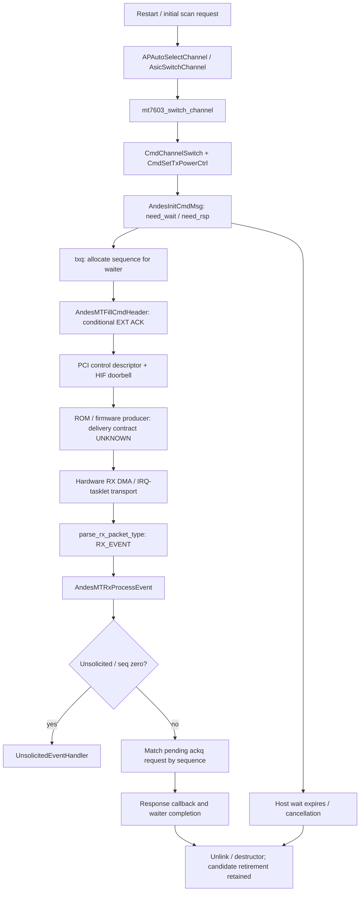
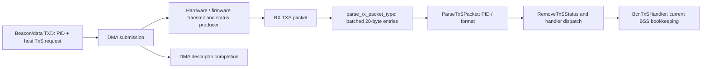

# WR1200JS MT7603E: ACK / TxS delivery boundary

Date: 2026-11-09. Status: **BLOCKED for safe MCU sequence reuse and late-TxS retirement; independent fail-closed IoT development may continue.** No production ACK patch or device operation was performed for this investigation.

## Evidence scope and notation

Vendor source revision: `c25283e915a2a00a763774dd255b14aff997285e`, directory `trunk/linux-4.4.x/drivers/net/wireless/mediatek/mt76x3/`. Source was read directly from the preserved exact Git archive, without extracting another driver tree. [Fresh source index](WR1200JS-MT7603-ACK-TXS-SOURCE-INDEX.json) records file hashes and line references. All vendor line numbers below refer to that pristine revision, not the generated candidate. Candidate changes are identified separately by generator/header path.

Working branch: `codex/wr1200js-service-webui`; published source checkpoint `ee6cc2ba4eeb4a22bf43661771d4a45a10868b22`; local documentation checkpoint `e93b609`. Existing unrelated modifications are preserved.

Labels used throughout:

- **PROVEN FROM SOURCE**: observed C/control flow, decoded initializer, or identified host counterexample; does not establish device behavior.
- **PROVEN FROM HARDWARE**: measured on the physical router. There is **no new evidence in this category** in this investigation.
- **INFERRED**: plausible interpretation needing additional evidence.
- **UNKNOWN**: the required firmware/ROM or physical contract is unavailable.

The owner's pasted investigation is the task. The supplied `mt7603_txs_psm_investigation_summary.md` is a hypothesis document, not an authoritative protocol specification.

## 1. Four different completion mechanisms

| Mechanism | Identifier / owner | Meaning and boundary | Evidence |
|---|---|---|---|
| MCU command ACK | MCU command sequence, vendor `cmd_msg`, `ackq` | A command-specific response/result event; not an 802.11 air ACK | PROVEN FROM SOURCE |
| MCU response/event | `EVENT_RXD`, EID/ext-EID/sequence; solicited or unsolicited | RX parser either dispatches unsolicited traffic or matches a pending command | PROVEN FROM SOURCE |
| Wireless TxS | TMAC PID, format, WCID, sequence/status fields; `TxSCtl` | Reports wireless transmission status, including beacon-specific callback bookkeeping | PROVEN FROM SOURCE |
| TX DMA completion | DMA descriptor/ring ownership | Host/HIF finished the relevant DMA operation; does not prove firmware event queues or RF activity are drained | PROVEN FROM SOURCE for descriptor ownership; later-producer absence UNKNOWN |

A low-power STA's 802.11 ACK timing is a fifth, air-interface issue. It is not the MCU sequence allocator. No capture here demonstrates ESP8266/ESP32 air ACKs exceeding a hardware timeout. Extending SlotTime/SIFS or disabling ACK globally would not address the demonstrated allocator witness.

## 2. Vendor command lifecycle and source map

| Source | Functions / fields and relevance |
|---|---|
| `include/mcu/andes_core.h` | `cmd_msg`, MCU queues, command timeout definitions; host completion ownership |
| `include/mcu/andes_mt.h` | `FW_TXD`, `EVENT_RXD`, extended command and response layouts |
| `mcu/andes_core.c:67` | `AndesInitCmdMsg`: `need_wait` and `need_rsp` are distinct; initializes completion only for waiters; sets `need_retransmit=0`, `retransmit_times=0` regardless of the constructor argument |
| `mcu/andes_core.c:222` | `AndesGetCmdMsgSeq`: original allocator cycles nonzero 1–15 and checks pending `ackq` |
| `mcu/andes_core.c:707` | `AndesDequeueAndKickOutCmdMsgs`: waiter receives allocated sequence; non-waiter receives sequence zero at lines725–729 |
| `mcu/andes_mt.c:259` | `AndesMTFillCmdHeader`: fills CID/ext-CID/set-query/sequence; ACK option depends on `need_rsp` at lines284–292 |
| `mcu/andes_mt.c:165` | `AndesMTPciKickOutCmdMsg`: control-ring submission; queues waiting request in `ackq`, other completion bookkeeping in `tx_doneq` at lines242–244 |
| `mcu/andes_core.c:783` | `AndesSendCmdMsg`: submission, wait, timeout/unlink/destruction paths; `AndesWaitForCompleteTimeout` at772 |
| `mcu/andes_mt.c:2892` | `AndesMTRxProcessEvent`: sequence zero/log/thermal event unsolicited; otherwise searches `ackq`, compares sequence before callback; waiter completion at2968–2969 |
| `mcu/andes_core.c:361,426,447` | dequeue, common RX parser entry, `AndesCmdMsgBh`; RX objects processed then freed; queue lock does not span the callback |
| `mcu/andes_core.c:104,134,531,626` | normal/forced destruction, PCI controller init/exit; software lifecycle is not a proven hardware epoch boundary |

**PROVEN FROM SOURCE:** `ackq` holds outstanding **requests**, not the upstream queue of response SKBs waiting for a future command. `rx_doneq` is transient transport work consumed by the tasklet, not equivalent to upstream `mcu.res_q`. PCI parsing and the Andes RX bottom half reach the shared parser; SDIO-only paths are not evidence of active PCI behavior.

**PROVEN FROM SOURCE:** host visibility begins when a completed RX descriptor/buffer is available to the driver and is parsed. Parsing a response is later than firmware generation. Source shows software list ordering, but does not prove total ordering across firmware, DMA rings and asynchronous events.

**PROVEN FROM SOURCE:** Linux PCI interrupt entry `os/linux/rt_pci_rbus.c:76` calls `RTMPHandleInterrupt` (`os/linux/rt_rbus_pci_drv.c:1299`). RX tasklet functions at339/423 call `rtmp_rx_done_handle` / `RxRing1DoneInterruptHandle`; these are vendor tasklet paths, not an assumed NAPI implementation. Beacon DMA completion is `common/cmm_data_pci.c:2663 RTMPHandleBcnDmaDoneInterrupt`, which reads the DMA index under `BcnRingLock`, unmaps/clears descriptor bookkeeping and separately tracks beacon DMA state. It is not `BcnTxSHandler`.

**UNKNOWN:** ROM versus downloaded-firmware responsibility for each result, duplicate cardinality, maximum latency, events surviving stop/start, and completeness of a proposed flush. `CMD_MSG_TIMEOUT=3000` is a host waiting policy, not a firmware promise that no response can arrive afterward. Init resets `cmd_seq`; that alone cannot distinguish an old response from a new command.

`LOAD_FW_ONE_TIME` / `AndesMTLoadFwMethod1` (`andes_mt.c:2220`) may recognize firmware already running and skip re-download. A host controller reopen therefore cannot be assumed to create a new ROM epoch.

## 3. Exact exhaustion mechanism

The [sequence reuse evidence](WR1200JS-IOT-MCU-SEQUENCE-REUSE-2026-11-01.json), [sender evidence](WR1200JS-IOT-MCU-SENDER-SOURCE-2026-11-01.json), [ACK investigation](WR1200JS-IOT-ACK-BLOCKER-INVESTIGATION-2026-11-07.md) and `tools/iot/mcu-sequence-reservation.h` describe two different policies:

1. **Original vendor — PROVEN FROM SOURCE:** nonzero 4-bit IDs wrap after15; occupancy checks do not exclude an already completed/timed-out command whose reply might arrive later.
2. **Checked candidate — PROVEN FROM SOURCE / host witness:** allocated IDs are permanently retired within the guarded epoch; destruction clears occupancy but not retirement; timeout quarantine is sticky. Cancellation before submission does not automatically recover the retirement budget.

Bootstrap consumes two IDs in the checked model. An 11/13-channel scan requiring channel-switch plus TX-power commands needs22/26 additional IDs. The negative witness reaches `occupied=0`, `retired=0xfffe`: **retirement-budget exhaustion, not proof of an occupied-slot or heap leak**. Some candidate guards refuse before reaching that scan. This is not physical reproduction of every startup failing.

Exact scan path: `common/rtmp_init_inf.c` auto-channel initialization → `ap/ap_autoChSel.c:1510 APAutoSelectChannel` → ASIC channel switch → `chips/mt7603.c:mt7603_switch_channel` → `CmdChannelSwitch` (`andes_mt.c:1930`, constructor1967) and `CmdSetTxPowerCtrl` (3396, constructor3414). Scan and normal channel branches call both at `chips/mt7603.c:61–71`. Private configuration wrappers must be audited separately from these pristine calls.

Increasing the pool, dropping retirement after completion, or using a host generation counter is not a safe correction without an echoed correlation field or producer boundary. Radio ON/OFF common result carries ext-CID/status, without an echoed requested ON/OFF value: a stale success with reused sequence can be ambiguous even when the command type matches.

## 4. Conditional ACK and upstream comparison

Primary references: [upstream fix](https://github.com/openwrt/mt76/commit/19b5d0918ba159bdb2ad248afe172502f558d65e), Linux commit `169c83d3df95b57e787174454332e01eb1b823ed`, and [current Linux MT7603 MCU source](https://codebrowser.dev/linux/linux/drivers/net/wireless/mediatek/mt76/mt7603/mcu.c.html). The Openwall page's explicitly LLM-generated explanatory appendix is excluded as evidence.

**PROVEN FROM SOURCE:** the referenced fix changes common MCU sequence-pointer handling and MT7996 ACK selection. Its mechanism prevents responses requested without a corresponding waiter from accumulating in a response queue. It does not establish safe sequence reuse for this proprietary driver.

Historical upstream `__mt7603_mcu_msg_send()` / `mt7603_mcu_msg_send()` naming differs from current `mt7603_mcu_skb_send_msg()` and `mt7603_mcu_parse_response()`. Upstream uses nonzero 4-bit sequence values, `mt76_mcu_get_response()` and RXD sequence validation. The inspected current MT7603 implementation still sets `ext_cid_ack=1` on extended commands; the MT7996 change is not automatically an MT7603 correction.

| Question | Proprietary MT7603E finding |
|---|---|
| Is EXT ACK unconditional? | No: TXD sets ACK only for EXT SET/QUERY with `need_rsp=true` (`andes_mt.c:284–292`). PROVEN FROM SOURCE. |
| Can a no-wait command request ACK? | Yes: `CmdSecKeyReq`, line810, has `need_wait=false`, `need_rsp=true`; seq becomes0. PROVEN FROM SOURCE. |
| Does this prove the scan cause? | No. Static audit found its definition/prototype but no in-tree caller; scan constructors are different. Effective preprocessing and external use still need checking. UNKNOWN as an active cause. |
| Do orphan responses accumulate like upstream? | Not demonstrated: vendor dispatches seq0 unsolicited and matches other events directly against pending requests. No equivalent response backlog established. |
| Can `need_rsp` simply be replaced by `need_wait`? | No: asynchronous response intent and firmware expectations must be resolved for every affected constructor first. |

Applicability: **mechanism useful for audit; direct patch not applicable as a proved fix**. No cherry-pick or ACK suppression is justified by this evidence.

## 5. TxS lifecycle is independent

**PROVEN FROM SOURCE:** `common/cmm_data.c:499/579–611` parses TxS separately from `RX_EVENT`; `GetPacketFromRxRing` (`common/cmm_data_pci.c:1688`, parser1836) and `AndesRxProcessCmdMsg` (`andes_core.c:426/433`) reach the parser. `AndesCmdMsgBh` dequeues before processing, so an empty work queue does not join a callback already running. [Call-chain evidence](WR1200JS-IOT-TXS-RX-CALLCHAIN-2026-11-08.json).

**PROVEN FROM SOURCE:** `tx_rx/txs.c:774 AddTxSStatus` overwrites the current slot even when `TXS_USED` (increments `TxSFailCount`), then increments `TxSPid`; it is not a search for a free 1–255 pool. `RemoveTxSStatus:798` marks the indexed slot unused and returns saved metadata. `ParseTxSPacket:675/691` removes it before handler dispatch. These original behaviors differ from the checked candidate ledger.

`mac/mt_mac.c:1009` allocates software metadata for packet-type TxS and independently sets host reporting. PID zero is not itself a no-report flag. The fields are in `include/mac/mac_mt/mt_mac.h`: TXD sequence12 plus validity, TxS PID8, sequence12, WCID8, raw `mpdu_tx_cnt`5 and format-dependent timestamp. A raw transmission count is not automatically a retry count; timestamp domain/wrap and sequence uniqueness are not established correlation contracts. [Correlation evidence](WR1200JS-IOT-TXS-CORRELATION-SOURCE-2026-11-08.json).

`BcnTxSHandler` (`txs.c:77`) uses software `Priv` to select BSS and updates beacon state/history. It does **not** itself universally free the transmitted SKB. DMA reclaim and status bookkeeping must be reviewed separately for each packet class. The supplied summary's universal TxS→DMA ownership→SKB-free claim is unsupported.

**PROVEN FROM SOURCE / host negative witness:** [ledger reuse witness](WR1200JS-IOT-TXS-LEDGER-REUSE-WITNESS-2026-11-08.json) permits an old PID report to consume a new reservation if the wire identity is reused. Host generation alone cannot reject it. This demonstrates ambiguity, not measured duplicate firmware delivery.

**UNKNOWN:** no-more-TxS boundary after per-BSS stop. A queue-busy readback, DMA-done observation, empty RX snapshot and callback join cover different stages; none alone excludes a later producer. Global RX stop or radio reset would also endanger Main/Guest. Original `APCheckBcnQHandler` (`hw_ctrl/cmm_asic_mt.c:1194–1395`) could continue after timeout; current `prepare-beacon-recovery-check.py` already makes the candidate fail closed there. That correction is not proof that late TxS is impossible.

## 6. E1 and E2: identity versus delivery contract

[Initializer identity evidence](WR1200JS-MCU-FIRMWARE-IDENTITY.json):

| Image | Size | Trailer version / build | SHA256 |
|---|---:|---|---|
| `MT7603_FirmwareImage`, `include/mcu/mt7603_firmware.h` |64132| `_e1_drv_tv` / `20140313215548` | `e1d9cabeeb7d1539ea94665f3e7527968166552e9fc28171e0af7dbaa34ac3a5` |
| `MT7603_e2_FirmwareImage`, `include/mcu/mt7603_e2_firmware.h` |74372| `CL173766_R` / `20171110105932` | `e897b5ca7277d77778dda75450956143709e39005affaf2b682c1e7d79fc4c64` |

**PROVEN FROM SOURCE:** `chips/mt7603.c:1101–1117` selects the E1 initializer for revisions before E2 under `MT7603_E1`, and E2 for E2-or-later under `MT7603_E2`; external filenames are `mtk/MT7603.bin` and `mtk/MT7603_e2.bin`. There are two distinct embedded initializers/trailers. This does not identify the owner's silicon revision, prove the loaded external `BIN_FILE_METHOD` image, or verify firmware CRC.

**INFERRED:** [E1/E2 common-result analysis](WR1200JS-MCU-E1-E2-COMMON-RESULT.json) identifies likely helpers copying the request sequence into a result and calling revision-specific external ROM routines. Disassembly is incomplete protocol evidence. The E2 startup analysis does not supply the missing ROM implementations.

**UNKNOWN for each revision independently:** exactly-once delivery, maximum delay, ordering, high sequence-bit preservation, complete reset semantics and late TxS invalidation. A result for E2 cannot be promoted to E1 or MT7612E. Shared-driver changes require 5-GHz regression too; no such hardware result is claimed here.

## 7. Alternatives and acceptance requirements

| Option | Correctness / races and E1/E2 scope | Required checks and rollback |
|---|---|---|
| A. Confirmed host ACK queue bug | Patch only after an executable counterexample identifies an ownership/lifetime defect. No upstream-like backlog cause confirmed here; request/RX races remain distinct. Host fix may cover both revisions, ROM proof does not follow. | Host callback/timeout/cancel race fixture, sanitizers, target driver compile, repeated physical scan/restart; revert isolated patch on regression. |
| B. Conditional ACK for no-response commands | Existing `need_rsp` gate already present. Resolve FALSE/TRUE constructor intent and effective callers before changing semantics. Different E1/E2 ACK behavior remains unknown. | Preprocessed constructor inventory, TXD fixture, exact target build and observed events for every changed command; retain original gate as rollback. |
| C. Host event drain | Reject as a reuse proof: a producer may emit after a snapshot/drain; dequeue is not callback join. Neither revision has a proven last-event marker. | Producer-stop proof plus all ingress/callback joins, adversarial delayed event test and hardware traces; keep reuse disabled until proved. |
| D. Safe reset/flush epoch | Requires documented reset acknowledgment invalidating all old producers/queues before reuse. Host init/exit and FW-already-running branch do not provide it. Radio-wide reset conflicts with ordinary IoT Main/Guest preservation. | Vendor E1/E2 reset contract, ring/IRQ/callback evidence and reset stress on both; revert to refusal if proof absent. |
| E. Pre-reserved third BSS | Best IoT design: cold-provision3 BSS, toggle only owned virtual BSS while Main keeps nonzero radio reference. This avoids restart/scan but does not prove late-TxS retirement. | Existing extracted-source reference-count test plus target compilation; physical ON/OFF, RF silence, races and Main/Guest traffic; fail closed/default OFF if close uncertain. |
| F. Separate blockers | Continue isolated API/controller/network development; leave MCU restart issue and TxS reopen gate explicit. Do not expose an unrestricted production toggle. Applies only to audited MT7603 target; other radios need separate evidence. | Exact source/image checks, full integrated build then physical acceptance; keep backend unbound or activation refused until its evidence contract passes. |

No alternative currently justifies a production ACK reuse patch. C and D are conditional research directions, not implemented workarounds. A host generation counter without firmware echo, arbitrary quarantine duration, larger pool, and serialization alone do not supply the missing guarantee.

## 8. IoT continuation and present implementation boundary

See [precreated lifecycle](../WR1200JS-IOT-PRECREATED-LIFECYCLE.md), [acceptance contract](../IOT-WIFI-IMPLEMENTATION-CONTRACT.md), [reopen gap](../WR1200JS-IOT-REOPEN-EVIDENCE-GAP.md).

| Requirement | Present evidence / remaining work |
|---|---|
| `BssidNum=3`, reserve ra2 during initial provisioning | Cold generator/profile and scoped target evidence; actual loaded ra2 on the router unverified. Ordinary ON/OFF must never regenerate that profile. |
| Guest as precedent | MBSS support does not prove every existing WebUI Guest apply path avoids physical restart. Reuse virtual-driver primitives, not an assumed restart-free Guest service wrapper. |
| Virtual open/close | `ap/ap_mbss_inf.c:132 MBSS_VirtualIF_Open`; `common/cmm_cfg.c:1034/1076` first/last physical reference behavior. Keep an owned Main reference across the entire operation. `ap/ap_mbss.c:246/293` CR changes are MMIO, not proof of drain. |
| No scan / physical restart | Extracted vendor reference-count fixture1000cycles and host dispatch checks; not an integrated physical measurement. Macro evidence for optional42407287069: MBSS enabled, beacon offload disabled; cannot generalize to untested descendants/configurations. |
| Safe OFF/reopen | Checked close/recovery ownership, callback/DMA handling remain staged; late-TxS producer boundary unresolved. Production activation/close-progress transport remains unbound. |
| Independent network | Dedicated bridge/subnet, DHCP/DNS and IPv4 isolation are separate software paths. Host packet fixtures do not prove real DHCP transactions or hardware offload isolation. IPv6 policy is DROP, not promised IPv6 internet. |
| Main/Guest preservation | Host injected-state evidence only; real associated-client traffic pending. |
| WebUI | Must reflect unavailable/refused/unknown state honestly; demo or controls alone are not completion. |

Continue next with the smallest fail-closed API/close-receipt integration package whose inputs and ownership are proven. Keep enable/reopen refused when retirement is unknown. Audit actual source composition before exposing endpoints; source-only helpers are not operational service integration. The ordinary cold startup/restart limitation remains documented and cannot be concealed by avoiding it in ON/OFF.

### PSM / retry diagnostic scope

`tools/iot/prepare-psm-diagnostics.py` supplies compile-time `WR_IOT_PSM_DIAG`, disabled by default. It is not an existing UI/procfs/iwpriv runtime switch. Hooks cover PSM transitions, PS queue idle cleanup, ageout, DTIM updates and received Format0 TxS. Five per-translation-unit event counters and bounded logs are not per-BSS hardware totals or measured firmware latency. WCID/status bits/raw transmit count must retain those names. Host off/on sanitizer checks do not demonstrate ESP traffic stability. No evidence currently proves PSM causes the MCU retirement exhaustion or a physical use-after-free.

## 9. Build and physical verification

Read-only CI snapshot during this audit:

- Standard exact `ee6cc2b`: run42626775333 success; [image evidence](WR1200JS-IOT-HWNAT-IMAGE-GATE-TARGET-EE6CC2B-2026-11-09.json). This covers its recorded image/source scope, not activated IoT.
- [Optional42630814928](https://github.com/Andrzej1973/padavan-4.4.198/actions/runs/42630814928): completed success; requested verification source `5d2a580`, dispatch head `ee6cc2b`. Workflow and candidate binaries independently inspected: [scoped evidence](WR1200JS-IOT-OPTIONAL-5D2A580-2026-11-09.json). Baseline, CLOSE object, WSC and PSM off/on hashes match reports;37 direct CLOSE assets match exact Git source. Four preserved generated-layer headers are recorded separately, not claimed reconstructed. CLOSE probe is not linked/installed and does not prove resource retirement.
- [Optional42630819652](https://github.com/Andrzej1973/padavan-4.4.198/actions/runs/42630819652): in progress at snapshot; requested source `ee6cc2b`. No result claimed.

No heavy build was started for this documentation investigation. No driver diff is proposed because the missing producer contract is not repaired by the available evidence.

After separate authorization for physical testing, record firmware SHA, silicon/image identity, loaded profile and instrumentation before:

1. Cold startup and repeated normal restart; auto-scan complete legal channel set; trace each MCU submission, sequence, result, timeout and retirement state.
2. Controlled delayed/duplicate/cancel fault injection in a host fixture first; compare physical event captures without deliberately corrupting production firmware protocol.
3. At least100 pre-reserved IoT ON/OFF cycles with continuous Main/Guest traffic, zero physical restart/scan deltas and no unaccounted TxS callbacks.
4. After OFF: RF silence, client rejection, all submission owners closed; delayed status cannot target a new BSS lifetime. Queue snapshots alone are insufficient.
5. Actual DHCP/DNS/internet, bidirectional LAN/Guest isolation, existing connections, IPv6 DROP, hardware offload, failure recovery and saved-state reboot tests.

## 10. Evidence needed to remove the blockers

Obtain independently for E1 and E2:

- ROM routines or vendor specification for command result enqueue/dequeue, retries/duplicates, sequence width and ordering.
- A proven finite reply lifetime or an explicit epoch/reset fence that invalidates every old response before allocator reuse.
- Exact reset/HIF/firmware state sequence, including already-running firmware behavior and RX DMA/IRQ/tasklet joins.
- A supported per-BSS no-more-transmission/no-more-TxS boundary covering hardware producer, queued DMA and callbacks, or an echoed non-repeating lifetime identity.
- Actual loaded firmware/silicon evidence and instrumented device tests matching those contracts. Finite passing stress tests support regression confidence; alone they do not prove an unbounded protocol safety property.

Scratch cleanup: source reads used memory only; no extracted build tree or temporary firmware copy was created. Retain this report and compact source index as reproducible evidence. Reclaimed space:0. Existing shared scratch/unfinished work was not deleted.

## Final decisions

`SAFE_TO_PATCH: NO` — no demonstrated safe production ACK/sequence-reuse correction; this does not prohibit separately proved host-only fixes.

`SAFE_TO_CONTINUE_IOT_WITHOUT_ACK_PATCH: YES` — isolated, fail-closed software development and verification only. **Not permission to enable unrestricted IoT, reuse TxS identities, claim runtime acceptance, or alter the router.**

`ROM_ACK_CONTRACT_PROVEN: NO`
