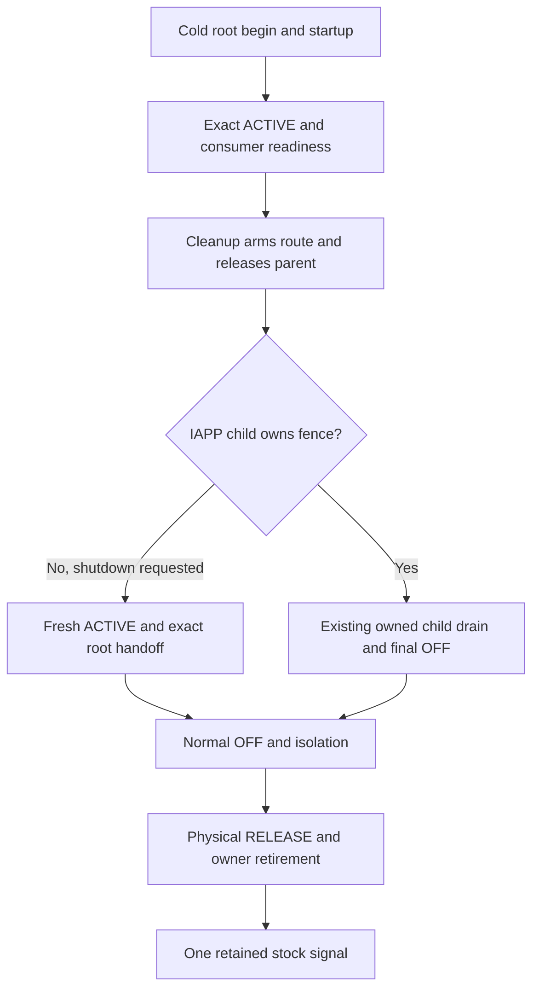

# Cold ACTIVE normal-shutdown lifecycle

Local integration on base502d497e, 2026-11-16. Full host suite28741 completed exit0;
target/image verification and physical runtime acceptance remain open.

The earlier gap was an unarmed normal-shutdown route after cold parent release.
Arming alone caused a circular wait: a routed shutdown forbids a new ordinary
IAPP fence, while the cold root's radio_on_owned exclusion forbids normal OFF.

The integrated path checks exact cold ACTIVE ownership plus normal consumer
readiness under the existing fence. Infallible cleanup publishes the route
before removing the borrowed parent, wiping credentials/profile and transferring
the exclusion. OFF/disabled/cancellation paths do not acquire this ACTIVE arm.

Before IAPP owns a child/fence, a routed TERM/QUIT causes the private handoff to
check exact release pointer, no remaining allocations, fresh ACTIVE and an
available normal consumer under the service guard. It retires only the root
and exclusion, preserving the independent backend and requested route. Normal
OFF then owns isolation, CLOSE and physical ARM/DOWN/RELEASE before stock signal.
Already attempted IAPP drains through the established final-shutdown path.

Source: tools/iot/rc-cold-detach.inc, rc-cold-release.inc,
rc-cold-route-handoff.inc, cold-on-root-signal.c, rc-normal-shutdown.c.
prepare-runtime.py stages the handoff; compile-runtime-link.sh requires its
export and readiness symbols. package-candidate-pair.py requires typed cold
arm/handoff bindings in the runtime lifecycle manifest.

Permanent check-cold-normal-backend-composition.py now executes actual
cold_root_begin/root_step, cold parent and same real backend through cleanup
TERM, normal OFF and physical RELEASE. Hardware/SDK/network commit boundaries
are actors. The final root-begin chain including spent-consumer and stale ACTIVE
negative assertions passed in full suite28741. Nine focused tests
23779 and live-child route55914 passed. Older cold-only fixtures explicitly
model only their reduced normal-consumer boundary; they do not prove controller
availability. The full composition and normal readiness test use the actual
controller. No ACK/protocol/global-queue/timing changes are made.

Do not mark the IoT port or this integration device-accepted from host checks.
Evidence: ../evidence/WR1200JS-COLD-ROUTE-INTEGRATION-2026-11-16.json.
