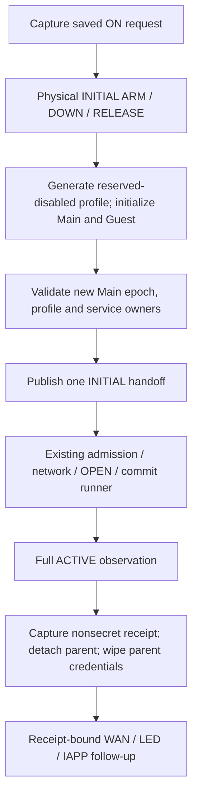

# WR1200JS saved-ON INITIAL restart lifecycle

Status: integrated experimental source, focused host checks passed. Full
regression, target, image and physical acceptance remain separate gates.
Production admission is not enabled by this implementation.

## Purpose and ownership

The physical INITIAL path has never opened ra2 in its original lifetime.
When saved IoT configuration is ON, RC captures that configuration before
ARM/DOWN. After the typed INITIAL RELEASE, Main is initialized with the
reserved IoT BSS disabled. A new adapter epoch and the exact generated
profile must be observed before the existing startup runner can open ra2.
No legacy CLOSE tuple is fabricated for this path.

`rc-physical-stop.c` owns the physical session and original desired request.
`restart-generation.c` owns the generated profile journal.
`restart-initial-parent.c` checks Main, Guest, services, multicast, profile
and physical-origin identity. `restart-initial-handoff.c` publishes one
handoff attempt before calling the backend; a refusal cannot retry START.

`rc-initial-restart-start.inc` borrows the exact parent and new Main identity
while the existing backend/runner owns startup resources. Generic, cold and
rebind entrypoints refuse interference while this binding is retained.
The actual full ACTIVE observer is required before successful finish.



## Experimental entry routing

The integrated entry package stages `initial-restart-entry.c` in the paired gated
restart hook after historical/cold ON selection and before existing-owned
restart. Its three results have distinct meaning: NATIVE delegates only an
inapplicable path; REFUSED stops the hook; OWNED includes retained physical
cleanup after a failed claim-time observation. Failed driver proof never
permits legacy fallback.

`initial-restart-select.c` reads software OFF, backend idle, live mode and two
fresh increasing IDLE receipts under a temporary guard. The physical selected
entry acquires its own fence/guard, captures saved desired state and repeats
the exact selected epoch/generation proof with newer serials. A mismatch
retains the claimed cleanup path before asynchronous ARM/DOWN. This does not
replace the physical controller's fresh ARM observations after AUX closure.

The entry/selector/physical composition injects epoch, generation, serial,
read-failure and TERM changes after selection. All hardware, software-policy
and transport observations are host actors. Binding in an experimental
prepared source is separate from production image admission and runtime
acceptance. Commit `ed81ded6` adds the automatic normal-shutdown route after
parent cleanup; target/image and device verification remain separate gates.

## Cancellation proofs

Cancellation distinguishes these cases rather than treating absence as CLOSE:

| Startup state | Required completion evidence |
| --- | --- |
| Published but unclaimed | No backend/runner binding, exact parent/profile/new Main, software OFF, two fresh increasing IDLE observations |
| Admission failure or STAGE | Owned snapshot released, no OPEN identity, fresh same-lifetime IDLE |
| Network work before OPEN | Existing pre-OPEN rollback complete, snapshot released, fresh IDLE |
| OPEN attempted, commit not completed | Exact explicit CLOSE and owner release, closed rollback complete, fresh CLOSED |
| DNS commit uncertain | Same CLOSE/rollback plus positive owned DNS abort; transaction disappearance alone is insufficient |
| DNS already committed or ACTIVE | Existing normal disable against current settings; fresh exact CLOSED; do not restore startup settings |

Guest must be observed DOWN before physical cancellation cleanup. Refused
observations retain ownership and do not replay START or invent receipts.

## Finish and shutdown

Cleanup detaches the borrowed parent before wiping its desired credentials.
The backend retains its own ACTIVE request for subsequent observation and
normal OFF. A receipt containing only request ID/time, adapter identity and
OPEN token survives parent cleanup and gates follow-up operations.

If shutdown is pending before successful finish, the owner routes scoped OFF
and proves CLOSED before cleanup and signal replay. During the WAN/IAPP tail,
an existing child drains first; the retained receipt binds normal OFF.
The conditional fence finish detects a signal delivered during its initial
SIG_SETMASK, retains admission and returns to the scheduler. This boundary check is complemented by the real cleanup-time TERM/QUIT
publication matrix and the composed shutdown consumer checks. The separate
`check-radio-stop-fence-cleanup-route.py` injects real TERM/QUIT inside cleanup
and proves that an already armed normal-shutdown route retains the first
request after cleanup, without a stock exit or new transaction admission.
That standalone matrix alone does not exercise the physical consumer.

Enabled INITIAL finish now checks the actual normal consumer is available,
after exact ACTIVE finish proof and before cleanup. If unavailable, it retains
parent, profile, credentials and admission. ACTIVE detach publishes the route
while admission is still active. A TERM arriving inside cleanup remains queued
and reaches this route after balanced cleanup. OFF/REJECTED cancellation and
disabled INITIAL do not publish an ACTIVE-only route.

`check-initial-auto-shutdown.py` covers readiness refusal and real TERM inside
cleanup with the actual backend and physical controller. The cancellation
matrix covers STAGE/NETWORK/COMMIT/COMMITTED/UNCERTAIN and disabled INITIAL.
`check-physical-scheduler-normal-shutdown.py` drains the same OFF backend after
actual scheduler/WAN/IAPP/root retirement through physical RELEASE, retiring
owners and credentials before one stock replay. Driver/network observations
remain actors. The prepared-source manifest records conditional INITIAL ACTIVE
arming; the route starts unarmed. Host success does not establish target,
image installation, hardware completion or device acceptance.

## Preparation and reproducibility

`tools/iot/prepare-runtime.py` installs both new translation units and headers,
and appends INITIAL private backend fragments before the cold backend.
`check-runtime-source.py` verifies the exact resulting source and headers.
All consumers of extended runner/rollback/restore structures must use the
same prepared header set.

Focused commands, run from repository root:

```sh
python3 tools/iot/check-physical-stop-client-preparation.py
python3 tools/iot/check-parent-backend-composed.py
python3 tools/iot/check-physical-scheduler-unmask-boundary.py
python3 tools/iot/check-normal-shutdown-arm.py
python3 tools/iot/check-initial-auto-shutdown.py
python3 tools/iot/check-initial-auto-cancel.py
python3 tools/iot/check-physical-scheduler-normal-shutdown.py
python3 tools/iot/check-physical-stop-suite.py
```

The composed checks use actual RC controllers, runner and scheduler, plus
host actors for driver, network, DNS and selected Guest adapters. The enabled
IAPP check starts only a temporary local test script. These checks do not
exercise the router or prove RF/DMA/IRQ completion. The MCU ACK protocol,
stale-ACK protection, global queues and radio timing are unchanged.

See `docs/evidence/WR1200JS-INITIAL-PERMANENT-INTEGRATION-2026-11-16.json`
for the current integration checkpoint and outstanding verification.

Current automatic shutdown host evidence: `docs/evidence/WR1200JS-INITIAL-AUTO-SHUTDOWN-APPLIED-2026-11-16.json`.
