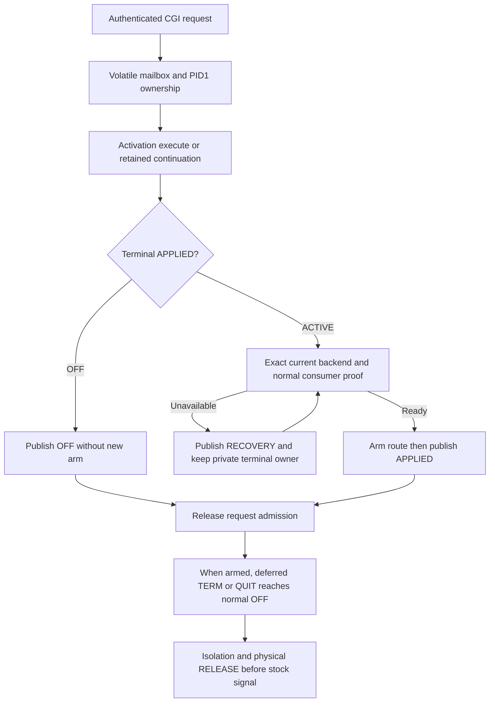

# Normal shutdown after ordinary CGI ON

Local implementation on base859b9769. All287 top-level host suite cases passed
across the preserved prefix, corrected fixtures and completed tail26021. New
target/image and device acceptance
remain open. Published optional1344 covers the preceding cold/INITIAL route.

The dedicated CGI only queues a request. Previously, control-server.c could
publish ordinary ON as APPLIED and release its admission while the backend was
ACTIVE and normal_route_armed was zero. The existing shutdown fixtures armed
that route explicitly, so they did not establish automatic arming for CGI ON.
The unarmed result was reproduced by session37398 before sending any shutdown.

The server now calls wr_iot_rc_backend_applied_route before terminal APPLIED
publication. Exact ACTIVE or rebind ACTIVE requires a fresh retained backend
observer and available normal controller, checked under the service guard.
The route is published before request admission can end. An already pending
TERM/QUIT may transfer at this terminal point; that grants no new ON admission.

| Backend result | Admission / route behavior |
| --- | --- |
| APPLIED ACTIVE | Exact ID/time and current resource/driver proof, then arm before terminal publication |
| APPLIED OFF or INITIAL_OFF | Match the retained OFF identity; do not acquire a new ACTIVE arm or clear an existing arm |
| Gate unavailable / stale ACTIVE | Publish RECOVERY, retain private APPLIED outcome and the same continuation/admission; retry the gate without executing ON again |
| REJECTED | Existing terminal cleanup; no new ACTIVE arm |

Implementation: control-server.c, control-channel.h, rc-backend.c and
rc-normal-shutdown.c/h under tools/iot. Runtime manifests and candidate-pair
validation require normal_shutdown_mailbox_active_arm_bound; target nm gates
require backend_applied_route and terminal_arm_ready exports.

Permanent check-mailbox-active-normal-shutdown.py uses actual mailbox, server,
backend/runner, normal controller and physical session. Its five processes cover
normal completion, spent consumer, TERM before publication, spent plus TERM and
stale ACTIVE epoch. Factory INITIAL_OFF first stays unarmed even with a spent
normal consumer, followed by ON and normal OFF/physical RELEASE. SDK/network/
hardware boundaries remain actors. Backend-only rebind checks use the actual
rebind observer but a reduced normal-consumer boundary; queue-only tests do not
claim automatic radio arming.

The first full run stopped at a duplicate actor/real-controller definition in
an INITIAL fixture. That fixture was corrected without changing production
logic; session29369 passed. Prefix19410, fixed29369 and suffix94358 jointly cover
the suite with corrected quiesce case34508 and completed tail26021 (exit0). The first suffix also exposed a derived
quiesce fixture expecting immediate stock TERM instead of the newly armed normal
physical route; its corrected assertion passed without production changes. No production or device
acceptance follows from a partially completed run.

No MCU protocol, ACK reuse, stale-ACK protection, TX queues, radio timing or
configuration persistence is changed. Saved-configuration/Classic integration
remains a separate unfinished requirement.
